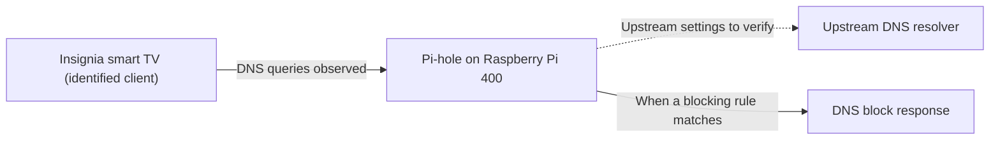

# Raspberry Pi — Pi-hole Project

**Brian Emerson · Independent project · October 2026–Present · Ongoing**

## Overview

This project documents my practical experience deploying Pi-hole on a Raspberry Pi 400 and learning about DNS filtering. It is a separate project from my coursework virtual lab, Ubuntu WSL 2 assessment, and portable Raspberry Pi capstone.

## Project work

- Set up Pi-hole on a Raspberry Pi 400.
- Practiced Linux administration and DNS troubleshooting.
- Reviewed how DNS-based filtering works and its limitations.

## Skills

Raspberry Pi, Linux, DNS, network troubleshooting, and technical documentation.

## Logical DNS flow

This is a **scoped conceptual diagram**, not a complete physical network map. The TV-to-Pi-hole link reflects the client attribution documented in the October 15 investigation. The downstream branches illustrate possible DNS filtering behavior; the actual upstream DNS configuration and individual response outcomes are not yet documented.

Other household clients and potential alternate DNS paths are not inventoried in this diagram.

## Case studies

- [Smart TV DNS investigation — October 15, 2026, with router-isolation follow-up — October 22–23, 2026](case-studies/smart-tv-dns-investigation-2026-10-15.md): documents the initial unplug/reconnect test and a later router-block/ping experiment. The follow-up distinguishes observed reachability and aggregate DNS activity from unverified device identity and cause.

## Evidence collection

- [DNS investigation evidence worksheet](docs/dns-investigation-evidence-checklist.md): a reusable template for time-stamped observations and privacy-safe validation. **This is a plan, not new test evidence.**

## Documentation roadmap

- [x] Add a scoped logical DNS-flow diagram (not a full network topology).
- [ ] Document software versions.
- [ ] Add sanitized examples, time-stamped observations, and test results.
- [ ] Record lessons learned.

These items are planned documentation, not completed validation results. No blocking rate or measured security improvement is claimed.

## Scope

DNS filtering is one layer of a broader security approach. This repository documents a learning project and does not claim complete network protection.

## Related projects

- [OctoPi printer management, 2020–2024](https://github.com/bemerson24/raspberry-pi-octopi)
- [Cybersecurity Virtual Lab Environment](https://github.com/bemerson24/cybersecurity-virtual-lab-environment)
- [Ubuntu WSL 2 Security Baseline](https://github.com/bemerson24/ubuntu-wsl2-security-baseline)
