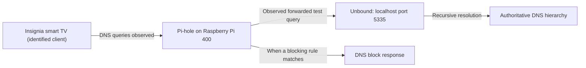

# Raspberry Pi — Pi-hole Project

**Brian Emerson · Independent project · October 2026–Present · Ongoing**

## Overview

**Portfolio overview:** [View the cybersecurity portfolio](https://github.com/bemerson24/cybersecurity-virtual-lab-environment/blob/main/PORTFOLIO-OVERVIEW.md).

I deployed Pi-hole on a Raspberry Pi 400 and investigated DNS-query patterns, VPN-dependent resolver behavior, and HTTPS dashboard access. On November 15–16, I added Docker-based availability monitoring with Uptime Kuma and connected Beszel host monitoring, while keeping Pi-hole and Unbound native. I verified Pi-hole forwarding to Unbound through an actual DNS query-log entry and documented a Beszel Agent configuration failure and recovery. This is my home DNS and monitoring project, separate from my VirtualBox lab and Ubuntu WSL 2 assessment.

## Project work

- Configured Pi-hole on my Raspberry Pi 400.
- Investigated local DNS resolution and VPN-dependent lookup behavior.
- Documented DNS-query observations, HTTPS recovery, and unresolved causes.
- Configured Unbound as Pi-hole's sole upstream at `127.0.0.1#5335`; tested DNSSEC's valid/invalid responses and captured Pi-hole's actual `en.wikipedia.org` forwarding log.
- Verified Docker Engine 29.9.3 and Docker Compose v5.7.1 on the Pi. Deployed Uptime Kuma with three checks for the home router, internet reachability and Pi-hole DNS resolution; all were Up in the observed monitoring snapshot.
- Validated a Uptime Kuma data backup (gzip integrity, expected SQLite/config entries and matching checksum after transfer to Windows), then switched to the `2-slim` Docker image and removed the larger image. Available storage increased from roughly 6.3 GB to 8.1 GB.
- Deployed the Beszel Hub and Agent in Docker and verified `home-dns` Up with populated **host CPU and memory** charts. I corrected a public-key placeholder and malformed `.env` entry before the Agent connected. Docker memory accounting initially failed because the kernel's memory cgroup controller was disabled; after a backed-up boot override and controlled reboot, refreshed Beszel graphs verified container CPU/memory/network monitoring alongside host storage, bandwidth and temperature panels.

## Skills

Raspberry Pi, Linux, DNS, TLS certificate troubleshooting, Docker Engine/Compose, containerized service monitoring, backup-integrity verification, capacity management and technical documentation.

## Logical DNS flow

This is a **scoped conceptual diagram**, not a complete physical network map. The TV-to-Pi-hole link reflects the client attribution documented in the October 15 investigation. The downstream filtering branch illustrates conditional blocking; the Unbound path below is supported by a separately observed forwarded DNS request, not a complete client-by-client path audit.

Other household clients and potential alternate DNS paths are not inventoried in this diagram. Pi-hole filters queries that reach it; this diagram does not establish that VPN or browser secure-DNS requests use Pi-hole. The November 2 case study records different local-name lookup results with the VPN connected and disconnected.

## Case studies

- [Smart TV DNS investigation — October 15, 2026, with router-isolation follow-up — October 22–23, 2026](case-studies/smart-tv-dns-investigation-2026-10-15.md): documents the initial unplug/reconnect test, router block and ping experiment, and a subsequent observation that aggregate Pi-hole activity stayed substantially lower after an older TV was added and kept active. This remains a preliminary observation, not proof that all outbound traffic stopped or that one device alone caused the network-wide change.

- [Laptop DNS portability and VPN troubleshooting — October 29, 2026](case-studies/laptop-dns-portability-vpn-2026-10-29.md): records campus website failures, recovery from Bitdefender VPN Error 9, and a still-unverified hypothesis about manually configured DNS across different networks.

- [Pi-hole HTTPS and VPN DNS troubleshooting — November 2, 2026](case-studies/pihole-https-vpn-dns-2026-11-02.md): records certificate inspection, Windows CA trust setup and VPN on/off DNS comparisons. HTTPS dashboard access was restored; the earlier campus and battery-related browsing failures remain unresolved.

- [Windows 11 / WSL2 DNS behavior with Bitdefender VPN and Pi-hole — November 15, 2026](case-studies/wsl2-bitdefender-pihole-dns-2026-11-15.md): controlled VPN-state comparison using Windows DNS over TCP, standard lookups, WSL2 unique-hostname probes and Pi-hole query-log evidence. VPN-state effects observed; exact DNS redirection/filtering mechanism unverified.

- **[Docker, Uptime Kuma and Beszel monitoring — November 15–16, 2026](case-studies/docker-uptime-kuma-beszel-monitoring-2026-11-15.md):** verified Docker/Compose, three Uptime Kuma availability checks, a hash-checked backup and slim-image migration, Unbound forwarding, and a functioning Beszel Hub/Agent connection with initial CPU metrics. A November 16 post-migration dashboard screenshot verified all three original monitors Up, plus the Uptime Kuma self-check; Beszel host CPU and memory graphs were also verified; November 16 kernel cgroup memory repair restored actual Docker per-container memory readings. Native Pi-hole and Unbound direct local DNS queries passed after reboot, and the refreshed Beszel dashboard showed populated Docker memory/CPU/network, disk, temperature and Wi-Fi data. Public evidence screenshots and alert-delivery testing remain pending. This is an **extension of my existing Pi-hole host**, not a completed SOC detection project.

## Evidence collection

- [DNS investigation evidence worksheet](docs/dns-investigation-evidence-checklist.md): a blank template for recording test times, observations and results.

## Documentation roadmap

- [x] Add a scoped logical DNS-flow diagram (not a full network topology).
- [x] Record observed software versions (Pi-hole Core v6.4.3, Web v6.6, FTL v6.7.1 as of November 11, 2026); recheck before claiming these are current.
- [x] Add case studies with command results and dated observations.
- [ ] Collect matched per-client DNS measurements for the TV follow-up.
- [x] Record troubleshooting lessons and unresolved questions.
- [x] Document the November 15 Docker installation, Uptime Kuma availability checks, backup integrity and image-size optimization as an existing-host extension.
- [x] Deploy the Beszel Agent and verify Hub connectivity with populated host CPU and memory metrics, keeping credentials private.
- [x] Recheck the original three Uptime Kuma monitors after the slim-image migration (all Up in November 16 dashboard, alongside Uptime Kuma self-check).
- [x] Resolve missing Docker memory accounting: traced `0B / 0B` reports to boot-time `cgroup_disable=memory`, backed up and appended `cgroup_enable=memory`, rebooted, and verified nonzero memory usage for all three containers.
- [x] Verify Pi-hole/Unbound post-reboot recovery: both services active; direct local lookups against Pi-hole and Unbound port 5335 returned A records.
- [x] Verify refreshed Beszel dashboard after reboot: Docker CPU/memory/network, host disk/I/O, bandwidth/load, thermal and Wi-Fi signal panels populated.
- [ ] Publish selected, privacy-reviewed dashboard evidence if useful; validate alert delivery and longer-term retention separately before claiming them.

The case studies contain my recorded results. The November 11 Pi-hole component versions are documented; matched TV query measurements remain unfinished.

## Scope

DNS filtering is one layer of a broader security approach. The documented tests cover specific clients and conditions; they do not establish complete network protection.

## Professional profile

[Brian Emerson on LinkedIn](https://www.linkedin.com/in/brianemersonpdx/) — professional background, education and career development.

## Related projects

- [OctoPi printer management, 2020–2024](https://github.com/bemerson24/raspberry-pi-octopi)
- [Cybersecurity Virtual Lab Environment](https://github.com/bemerson24/cybersecurity-virtual-lab-environment)
- [Ubuntu WSL 2 Security Baseline](https://github.com/bemerson24/ubuntu-wsl2-security-baseline)

