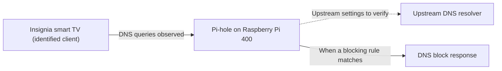

# Raspberry Pi — Pi-hole Project

**Brian Emerson · Independent project · October 2026–Present · Ongoing**

## Overview

**Portfolio overview:** [View the cybersecurity portfolio](https://github.com/bemerson24/cybersecurity-virtual-lab-environment/blob/main/PORTFOLIO-OVERVIEW.md).

Pi-hole deployment on a Raspberry Pi 400, with DNS-query investigations, VPN/local DNS comparisons and HTTPS dashboard troubleshooting. This environment is separate from the VirtualBox lab, Ubuntu WSL 2 assessment and planned portable Raspberry Pi lab.

## Project work

- Set up Pi-hole on a Raspberry Pi 400.
- Investigated local DNS resolution and VPN-dependent lookup behavior.
- Documented DNS-query observations, HTTPS recovery and unresolved causes.

## Skills

Raspberry Pi, Linux, DNS, TLS certificate troubleshooting and technical documentation.

## Logical DNS flow

This is a **scoped conceptual diagram**, not a complete physical network map. The TV-to-Pi-hole link reflects the client attribution documented in the October 15 investigation. The downstream branches illustrate possible DNS filtering behavior; the actual upstream DNS configuration and individual response outcomes are not yet documented.

Other household clients and potential alternate DNS paths are not inventoried in this diagram. Pi-hole filters queries that reach it; this diagram does not establish that VPN or browser secure-DNS requests use Pi-hole. The November 2 case study records different local-name lookup results with the VPN connected and disconnected.

## Case studies

- [Smart TV DNS investigation — October 15, 2026, with router-isolation follow-up — October 22–23, 2026](case-studies/smart-tv-dns-investigation-2026-10-15.md): documents the initial unplug/reconnect test, router block and ping experiment, and a subsequent observation that aggregate Pi-hole activity stayed substantially lower after an older TV was added and kept active. This remains a preliminary observation, not proof that all outbound traffic stopped or that one device alone caused the network-wide change.

- [Laptop DNS portability and VPN troubleshooting — October 29, 2026](case-studies/laptop-dns-portability-vpn-2026-10-29.md): records campus website failures, recovery from Bitdefender VPN Error 9, and a still-unverified hypothesis about manually configured DNS across different networks.

- [Pi-hole HTTPS and VPN DNS troubleshooting — November 2, 2026](case-studies/pihole-https-vpn-dns-2026-11-02.md): records certificate inspection, Windows CA trust setup and VPN on/off DNS comparisons. HTTPS dashboard access was restored; the earlier campus and battery-related browsing failures remain unresolved.

## Evidence collection

- [DNS investigation evidence worksheet](docs/dns-investigation-evidence-checklist.md): a blank template for recording test times, observations and results.

## Documentation roadmap

- [x] Add a scoped logical DNS-flow diagram (not a full network topology).
- [ ] Document software versions.
- [x] Add case studies with command results and dated observations.
- [ ] Collect matched per-client DNS measurements for the TV follow-up.
- [x] Record troubleshooting lessons and unresolved questions.

The case studies contain the recorded results. Software versions and matched TV query measurements still need documentation.

## Scope

DNS filtering is one layer of a broader security approach. The documented tests cover specific clients and conditions; they do not establish complete network protection.

## Related projects

- [OctoPi printer management, 2020–2024](https://github.com/bemerson24/raspberry-pi-octopi)
- [Cybersecurity Virtual Lab Environment](https://github.com/bemerson24/cybersecurity-virtual-lab-environment)
- [Ubuntu WSL 2 Security Baseline](https://github.com/bemerson24/ubuntu-wsl2-security-baseline)

## Professional profile

[Brian Emerson on LinkedIn](https://www.linkedin.com/in/brianemersonpdx/) — professional background, education and career development.
