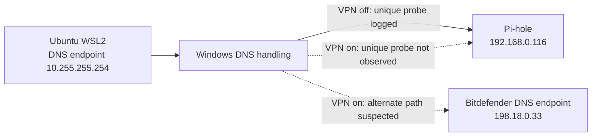

# Windows 11 / WSL2 DNS behavior with Bitdefender VPN and Pi-hole

**Investigation date:** November 15, 2026  
**Status:** Controlled VPN-on/off comparison completed; root mechanism unresolved  
**Environment:** Personal home network, not campus or employer infrastructure

## Objective

Determine whether DNS lookups initiated from Ubuntu on WSL2 reach a Raspberry Pi Pi-hole resolver when Bitdefender VPN is connected versus disconnected. Distinguish name-resolution success from evidence that a particular DNS server actually received the request.

This investigation extends the earlier [Pi-hole HTTPS and VPN DNS troubleshooting](pihole-https-vpn-dns-2026-11-02.md), including the November 11 follow-up. It is not a security-incident claim.

## Environment and verified baseline

| Component | Observed configuration |
| --- | --- |
| Host | Windows 11 Pro; PowerShell 5.1 |
| Linux | Ubuntu 26.04.1 LTS on WSL2 |
| WSL2 networking | `eth0` at `172.30.215.47/20`; gateway `172.30.208.1` |
| WSL2 resolver | `/etc/resolv.conf` contains `nameserver 10.255.255.254`; file marked auto-generated by WSL |
| Wi-Fi DNS | `192.168.0.116` listed twice (local Pi-hole) |
| Bitdefender TAP adapter | `Local Area Connection`, UP; DNS `198.18.0.33` |
| Pi-hole client attribution | Windows host LAN address `192.168.0.96` |
| Effective Windows NRPT | `Get-DnsClientNrptPolicy -Effective` returned no entries |

The WSL resolver address is consistent with Windows-managed WSL DNS tunneling. Its configuration alone does **not** prove which upstream DNS server handles each lookup. Likewise, Windows displaying Pi-hole on Wi-Fi does not prove all applications use Pi-hole while the VPN is connected.

## Reproducible tests and observed outcomes

Run these in **Windows PowerShell on the host**, not inside a VirtualBox guest. The test names below correspond to the recorded November 15 session.

| VPN condition | Command or inspection | Observed result | Interpretation |
| --- | --- | --- | --- |
| Connected | `Test-NetConnection 192.168.0.116 -Port 53` | `TcpTestSucceeded : True`; source `192.168.0.96`, interface Wi-Fi | TCP port 53 reachable; not proof a DNS question is answered |
| Connected | `nslookup example.com 192.168.0.116` | Repeated DNS timeouts | Ordinary direct DNS lookup failed in this condition |
| Connected | `Resolve-DnsName -Name example.com -Type A -Server 192.168.0.116 -TcpOnly -DnsOnly` | Two A answers: `172.66.147.243`, `104.20.23.154` | Direct Pi-hole DNS answer over TCP succeeded |
| Disconnected | `nslookup example.com 192.168.0.116` | `Server: pi.hole`; IPv4 and IPv6 answers | Direct lookup succeeded with VPN disconnected |
| Disconnected | `wsl -d Ubuntu -- getent ahostsv4 wsl-probe-20261115-02.example.com` | No IP printed; matching A query appeared in Pi-hole Query Log | WSL-generated unique lookup reached Pi-hole |
| Connected (I verified the VPN state) | `wsl -d Ubuntu -- getent ahostsv4 wsl-vpn-confirmed-20261115.example.com` | No IP printed; **no matching query** in filtered Pi-hole log after disconnecting VPN to inspect it | Pi-hole receipt not observed in this VPN-on test |
| Connected | `wsl -d Ubuntu -- getent ahostsv4 example.com` | Two IPv4 answers returned | WSL hostname resolution remained functional; cache/upstream not independently identified |
| Connected | `Resolve-DnsName -Name example.net -Type A -Server 198.18.0.33 -DnsOnly` | Two A answers: `104.20.21.8`, `172.66.175.59` | The Bitdefender adapter's configured DNS endpoint could answer a direct query |
| Connected | `Get-DnsClientNrptPolicy -Effective` | No output | No effective NRPT rule returned; other VPN DNS handling remains possible |

For the WSL negative test names, no returned address is expected: the hostnames were deliberately chosen as unlikely-to-exist probes. A blank `getent` result alone is **not** evidence of DNS-path failure.

### Pi-hole-side corroboration

The Pi-hole Query Log filter showed **one A query** for `wsl-probe-20261115-02.example.com` on November 15 at approximately **11:19:09 AM** from `192.168.0.96`. This supports a route from WSL's request through Windows DNS handling to Pi-hole, with the Windows host shown as client.

For `wsl-vpn-confirmed-20261115.example.com`, I confirmed Bitdefender was **connected during the WSL lookup**, then disconnected it to access the Pi-hole dashboard. The matching domain filter returned **no records**.

An earlier hostname containing `vpn-on` was in fact tested **with the VPN disconnected**. It is excluded from the VPN-on evidence rather than reclassified based on its name.

### Logical interpretation (not a packet-level route proof)

The dotted paths are hypotheses or absent-log observations, not captured packet flows.

## Findings

1. Pi-hole remained reachable over **TCP port 53** with Bitdefender VPN connected, and a DNS A query **forced over TCP** succeeded.
2. The standard `nslookup` request to Pi-hole timed out with the VPN connected but succeeded with it disconnected. This is consistent with protocol-specific interference, but the precise cause was not isolated.
3. WSL's unique VPN-off DNS probe appeared in Pi-hole's log; the separately named, VPN-on probe did not appear in the filtered log under the observed conditions.
4. WSL could still resolve a public domain while VPN-connected, and the Bitdefender-adapter DNS endpoint responded to a direct query. The **automatic** upstream resolver selected by WSL for that public lookup was not independently proven.
5. No effective NRPT entries were returned. That does not rule out adapter metrics, DNS tunneling behavior, caching, client policy, VPN filtering, or other routing mechanisms.

**Conclusion:** VPN connection state correlates with changes in the observed local Pi-hole DNS path. The investigation does **not** establish that the VPN universally blocks Pi-hole, that all UDP/53 packets were filtered, or that WSL always redirects to `198.18.0.33`.

## Evidence, limits, and next steps

**Collected during the session:** Windows PowerShell outputs for adapter/DNS inventory, TCP port test, direct standard and TCP-only DNS queries, WSL configuration and name-resolution tests; Pi-hole query-log screenshots for the matched VPN-off probe and unmatched VPN-on probe.

**Repository evidence limitation:** The screenshots were reviewed in the working session; the image files are **not included in this commit**. The commands and observed outcomes above are transcribed from that session. Do not treat this document as a packet capture or independently archived PCAP.

**Not performed:** simultaneous network capture across the host/VPN/Pi-hole interfaces; server-side query-log export; TCP-only VPN-off control; explicit UDP packet capture; verification of Windows resolver-selection policy for every process. Absence of a Pi-hole query-log entry is not proof of packet blocking.

Potential next investigation: correlate timestamped packet capture or Pi-hole FTL query logs with the same unique-name lookup under matched VPN conditions, if that can be done without weakening host security or interrupting the home network.

## Relevance

This project demonstrates controlled A/B testing, protocol-aware DNS troubleshooting, Linux/Windows interoperability, client/server evidence correlation, and the difference between an observed outcome and an inferred network path.

*I used writing assistance to organize the commands, outputs, and screenshots from my investigation. I have not presented any packet-level routing mechanism as verified.*
