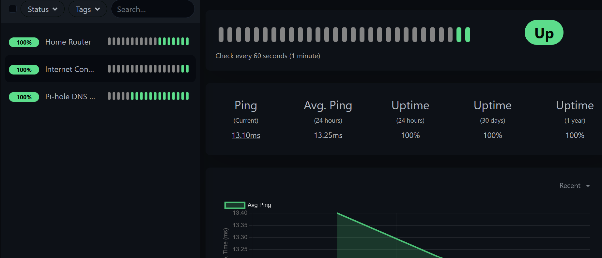

# Uptime Kuma availability-monitoring evidence — November 15–16, 2026

## Provenance

This file is a privacy-reviewed copy of the real screenshot `image(20261116-042355).png`, supplied during the November 15–16 monitoring session. The source was available in the user's file library. The filename is a session reference, not proof of the precise time the screenshot was taken.

The source PNG was converted from RGBA to RGB to remove ancillary image metadata. **Every visible RGB pixel matches the source.** No labels, values, graphs, monitor names or results were reconstructed or changed. No opaque masks were necessary in this capture: no visible hostname, SSID, username, private IP address, credentials or personal account details were identified during manual review.

| Evidence file | SHA-256 |
| --- | --- |
| Original `image(20261116-042355).png` | `395803291f8e63da961cb27ffc241abf3d460235967fefb5413710650c437f17` |
| Published `01-uptime-kuma-three-monitors-session-2026-11-15.png` | `ce59633d5abdf85f86fb401b09ae5d40dbdc0c1ecaaa70882a362c99ff56ddb6` |

## What the screenshot demonstrates

- **Home Router**, **Internet Connectivity**, and **Pi-hole DNS Resolution** are the three visible original monitors, each displaying a green `100%` status in the sidebar.
- The **Internet Connectivity** monitor is selected and reports **Up**, a **60-second** check interval, a current ping of **13.10 ms**, and a displayed 24-hour average ping of **13.25 ms**.
- The dashboard displays **100%** for the selected monitor's 24-hour, 30-day, and one-year fields; these are interface claims visible at capture, **not** independently validated continuous uptime over those periods.

## Limits and follow-up

This is an **earlier three-monitor screenshot**. It does **not** show the Uptime Kuma self-check and must **not** be described as the separate post-slim-migration four-monitor dashboard check documented in the [case study](../../case-studies/docker-uptime-kuma-beszel-monitoring-2026-11-15.md). The latter observation was documented in the work session but its original screenshot has not been recovered for public archival here.

This image is a scoped availability-monitoring observation, **not** evidence of an alert-delivery test, backup restoration, uninterrupted service across maintenance, network compromise, or SOC security detection. The monitoring configuration and database are not published. Earlier raw source images remain private.
